# Dry Nozzle Inspection

> Camera-based inspection of the spray nozzle lances inside an industrial spray dryer. The system finds each lance, decides whether it is spraying, and measures the spray-cone angle only when the camera can actually see it.

[](LICENSE)
[](https://www.python.org)
[](deployment/pi5_final/)
[](deployment/pi5_final/)

<p align="center">
  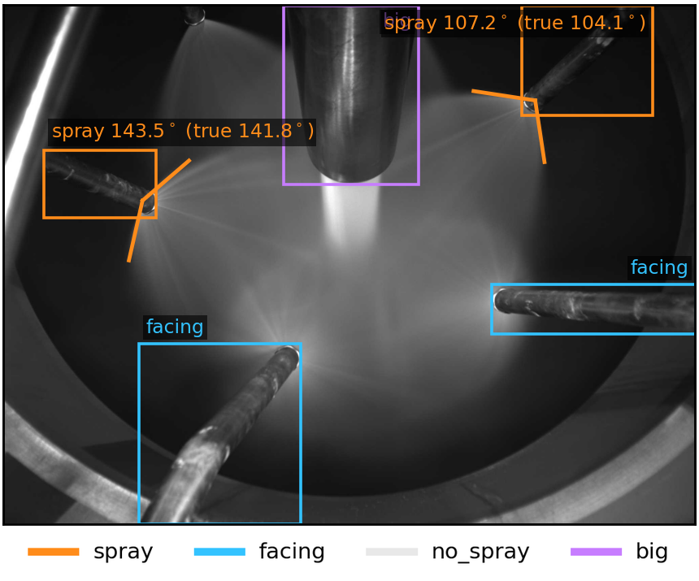
  <br>
  <sub>Final model (seed 42) on a held-out test frame. Orange boxes are spraying lances, labelled with the predicted cone angle and the annotated value in brackets.</sub>
</p>

Spray drying turns liquid feed into powder, and the nozzle lances inside the dryer wear and clog while the plant runs. Heat limits where a camera can go, so **one fixed camera has to watch several lances at once**, and not every lance can be measured from that view. A spray cone shows its true opening angle only when it is seen from the side. Seen along its axis, it collapses into a disc.

This repository contains the code of the Master's thesis *Observability-Aware Multi-Task Learning for Spray Nozzle Inspection* (Halmstad University, 2026). It has two parts:

| Part | What it is | Where |
| :--- | :--- | :--- |
| **Final model**, AFGNet v10 (thesis) | Multi-task network with a **mist evidence map**. Detects each lance, gates its state from the mist, and reads the apex angle with a small learned reader. Exported to ONNX and benchmarked on a Raspberry Pi 5. | [`train/model_2/`](train/model_2/), [`deployment/pi5_final/`](deployment/pi5_final/) |
| **Live inspection app** (OpenCV + AFGNet v10) | Interactive runtime. An OpenCV engine measures nozzle geometry, spray angle and buildup on every frame, and the final AFGNet v10 model adds the lance state (from the mist gate) in the background. The earlier AFGNet v9 can still be selected. | [`app/run_inspection.py`](app/run_inspection.py), [`src/nozzle_inspection/`](src/nozzle_inspection/) |

> **What is not in this repository.** The recordings come from an industrial process line, so the dataset (frames, labels, videos) and the trained weights are not published. The code, the model definition, the training and evaluation scripts and the Raspberry Pi 5 pipeline are all here, and the app runs on your own camera or video file.

## Table of Contents

- [Highlights](#highlights)
- [The Problem: Observability](#the-problem-observability)
- [Final Model (AFGNet v10)](#final-model-afgnet-v10)
  - [Architecture](#architecture)
  - [Mist evidence map](#mist-evidence-map)
  - [Angle reader](#angle-reader)
  - [Results on the test set](#results-on-the-test-set)
  - [Measuring or recalling?](#measuring-or-recalling)
  - [Failure cases](#failure-cases)
  - [Raspberry Pi 5 deployment](#raspberry-pi-5-deployment)
  - [Training and evaluation](#training-and-evaluation)
- [Live Inspection App (OpenCV + AFGNet v10)](#live-inspection-app-opencv--afgnet-v10)
  - [Installation](#installation)
  - [Quick start](#quick-start)
  - [Pipeline A: OpenCV](#pipeline-a-opencv)
  - [Pipeline B: AFGNet (ONNX)](#pipeline-b-afgnet-onnx)
  - [Fusion and class gate](#fusion-and-class-gate)
  - [Auto-ROI: the AI proposes, CV refines](#auto-roi-the-ai-proposes-cv-refines)
  - [Runtime architecture](#runtime-architecture)
  - [v9 results](#v9-results)
- [Dataset](#dataset)
- [Project Structure](#project-structure)
- [Configuration](#configuration)
- [Troubleshooting](#troubleshooting)
- [Glossary](#glossary)
- [License and Citation](#license-and-citation)

## Highlights

Results of the final model on the held-out test set, for two training seeds:

| | Seed 42 | Seed 123 |
| :--- | :---: | :---: |
| Test lances reported with the **correct state** | **93.06 %** (8152 / 8760) | 76.06 % (6663 / 8760) |
| Mean state F1 (4 classes) | 0.919 | 0.787 |
| `no_spray` F1, mist gate vs. classification head alone | **0.925** vs. 0.002 | 0.747 vs. 0.067 |
| Apex-angle error of the reported sprays (MAE) | 2.14° | 1.76° |
| Raspberry Pi 5, CPU only, end to end | 134 ms · **7.41 FPS** | 132 ms · **7.52 FPS** |
| Model size | 7.4 MB network + 0.4 MB angle reader | same |

What the thesis shows:

- **Class-routed loss masking is necessary.** Without it, the keypoint error rises from about 2° to about 12°, and the angle reader that depends on those keypoints fails with it.
- **The mist map decides the lance state** far better than the classification head, especially for idle lances.
- **The angle reader measures, the keypoint branch recalls.** Both reach a low error, but only the reader's prediction changes when the true angle is changed by a probe. It recovers six to nine degrees out of every ten.
- **Limits:** all angle labels come from one recording with three lances, and the state accuracy still varies with the training seed.

## The Problem: Observability

The camera sees a cone with true half-angle α from a viewing angle θ. The apparent apex angle 2α′ equals the true angle only at a perpendicular view. It widens under oblique views and collapses toward a circle near the cone axis.

<p align="center">
  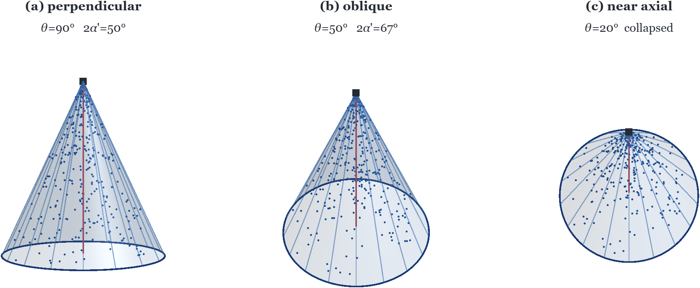
  <br>
  <sub>The same cone (2α = 50°) at three viewing angles: (a) perpendicular, 2α′ = 50°; (b) oblique, 2α′ = 67°; (c) near axial, collapsed.</sub>
</p>

So the angle task is **meaningful on some detections and not on others**. Standard multi-task learning assumes every task applies to every sample. Here the tasks are nested by what the camera can see:

| Class | Lance state | Angle measurable? |
| :--- | :--- | :---: |
| `spray` | Spraying, cone seen from the side | ✅ |
| `facing` | Spraying toward the camera | ❌ (cone not observable) |
| `no_spray` | Idle | ❌ (no cone) |
| `big` | The large central lance | ❌ |

## Final Model (AFGNet v10)

### Architecture

One forward pass on a 640 × 480 frame produces per-cell grid outputs and a mist evidence map. During training, a class-routed loss decides which cells each term trains on. During inference, three nested tiers run in order: detect the lance, decide whether it is spraying, and, only for a measurable spray, read the apex angle.

<p align="center">
  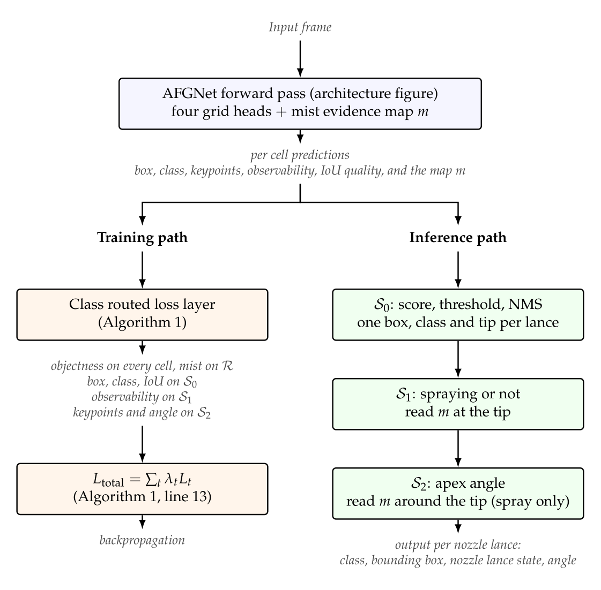
  <br>
  <sub>System pipeline, rendered from the thesis figure (Chapter 4). Left, the training path. Right, the inference path, where S<sub>1</sub> and S<sub>2</sub> read the mist map <i>m</i> at the tip located by S<sub>0</sub>.</sub>
</p>

Inside the network:

<p align="center">
  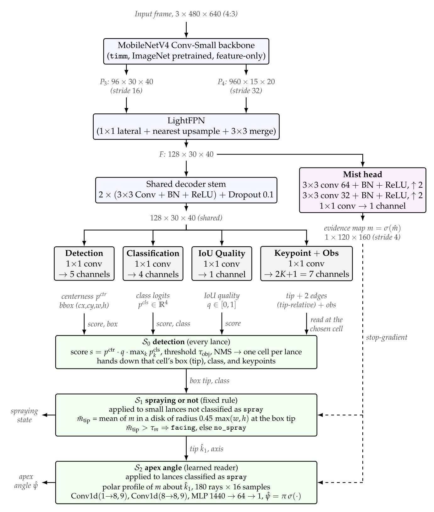
  <br>
  <sub>AFGNet architecture, rendered from the thesis figure (Chapter 4). A mist head reads the FPN features and upsamples them into a stride-4 evidence map <i>m</i>. S<sub>0</sub> turns the four grid outputs into one detection per lance, S<sub>1</sub> decides whether each small lance is spraying, and S<sub>2</sub> reads the apex angle of measurable sprays only. The last two read a detached copy of <i>m</i> around the tip that S<sub>0</sub> located.</sub>
</p>

| Tier | Applied to | Rule |
| :--- | :--- | :--- |
| **S0** detection | every lance | score = centerness · IoU quality · max class prob, threshold 0.35, NMS → one box, class and tip per lance |
| **S1** spraying or not | small lances not classified `spray` | mean of *m* in a disk of radius 0.45 · max(w, h) at the tip: above the gate threshold → `facing`, otherwise → `no_spray` |
| **S2** apex angle | lances classified `spray` | polar profile of *m* around the tip (180 rays × 16 samples) → 1-D conv reader → angle ψ |

**Class-routed loss masking.** Each loss term is trained only on the cells where it is physically meaningful. The ground-truth class routes the grid terms to the nested subsets S<sub>2</sub> ⊆ S<sub>1</sub> ⊆ S<sub>0</sub>. Objectness is trained on every cell, box, class and IoU on S<sub>0</sub> (all lances), observability on S<sub>1</sub> (`spray` and `facing`), and keypoints only on S<sub>2</sub> (`spray`). The mist term is trained on the loss region only. The angle reader is trained per `spray` instance on a detached copy of the map.

<p align="center">
  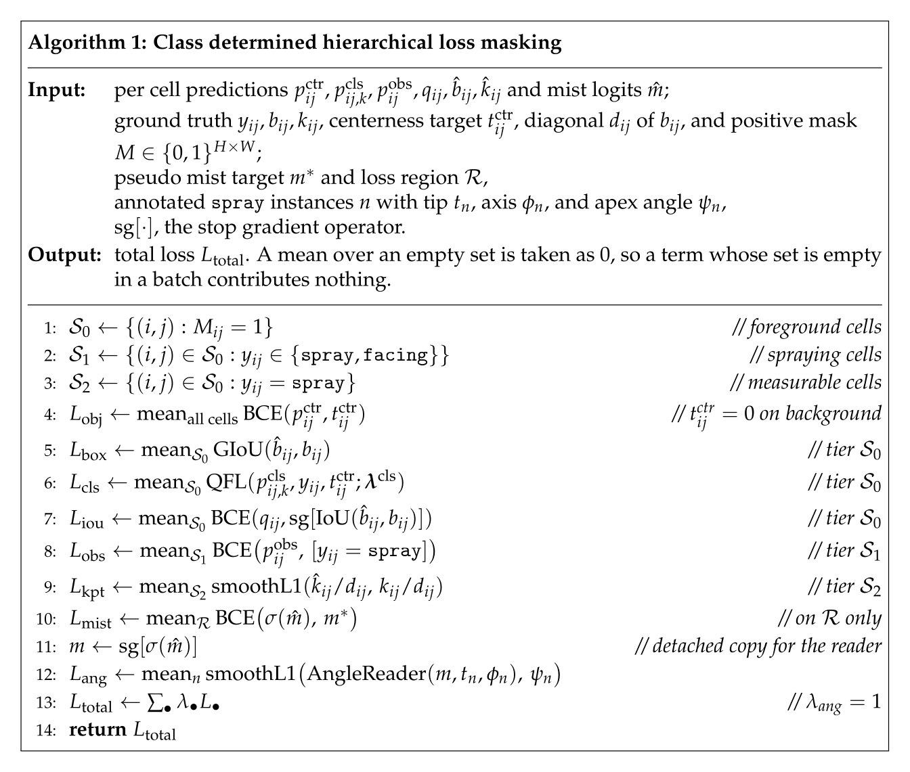
  <br>
  <sub>Algorithm 1 of the thesis: class-determined hierarchical loss masking.</sub>
</p>

The network has 1.93 M parameters, and the angle reader has 93 k.

### Mist evidence map

The mist head is supervised by an automatic target built from the frame itself, so no extra labelling is needed. The target combines excess brightness with edge suppression, and it is restricted to a region around the annotated lances.

<p align="center">
  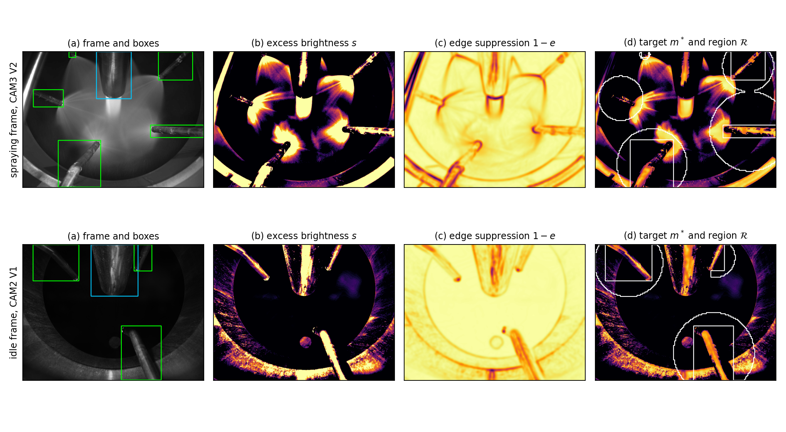
  <br>
  <sub>Automatic mist target on a spraying frame (top, CAM3 V2) and an idle frame (bottom, CAM2 V1): (a) annotated boxes, (b) excess brightness, (c) edge suppression, (d) target and training region.</sub>
</p>

### Angle reader

For a `spray` lance, the reader casts 180 rays around the cone axis on the mist map. It averages the map along each ray and regresses the apex angle from the resulting profile.

<p align="center">
  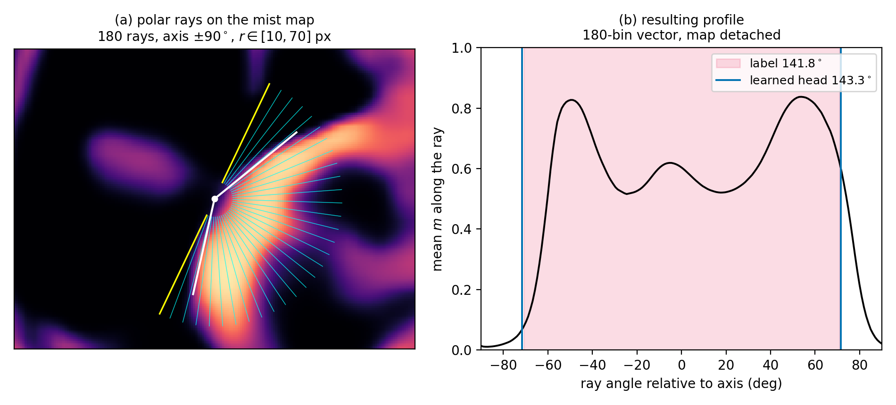
  <br>
  <sub>(a) Polar rays on the mist map, with the annotated cone edges in white. (b) The angular profile. The annotated angle (141.8°) is shaded, and the reader predicts 143.3°.</sub>
</p>

### Results on the test set

The test set holds 2255 frames from recordings never used for training (see [Dataset](#dataset)).

<p align="center">
  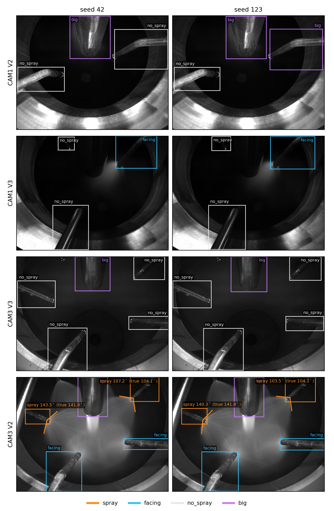
  <br>
  <sub>One test frame per recording, seed 42 (left) and seed 123 (right). The box colour is the reported lance state. Spray labels show the predicted angle with the annotated angle in brackets.</sub>
</p>

**Detection and state.** `spray` and `big` come from the classification head, and `no_spray` and `facing` come from the mist gate.

| Output | Seed | `spray` | `no_spray` | `facing` | `big` | Mean |
| :--- | :---: | :---: | :---: | :---: | :---: | :---: |
| Reported state, F1 | 42 | 0.800 | 0.925 | 0.980 | 0.971 | **0.919** |
| | 123 | 0.800 | 0.747 | 0.818 | 0.782 | 0.787 |
| Reported state, AP50 | 42 | 0.636 | 0.890 | 0.909 | 0.909 | 0.836 |
| | 123 | 0.636 | 0.704 | 0.725 | 0.909 | 0.743 |
| Classification head only, F1 | 42 | 0.800 | 0.002 | 0.704 | 0.971 | 0.619 |
| | 123 | 0.800 | 0.067 | 0.582 | 0.782 | 0.558 |

**Apex angle** (MAE in degrees). *All* covers every annotated `spray` instance (89). *Kept* covers the instances the deployed system reports (59).

| Output | Seed 42, all | Seed 42, kept | Seed 123, all | Seed 123, kept |
| :--- | :---: | :---: | :---: | :---: |
| Angle reader (reported) | 1.65 | 2.14 | 2.16 | 1.76 |
| Keypoint branch | 1.24 | 1.56 | 1.69 | 2.21 |
| Position-lookup baseline | 0.77 | 0.73 | 0.77 | 0.73 |
| Constant baseline | 18.05 | — | 18.05 | — |

The position-lookup baseline, which returns the mean angle of the training lance at the same position, beats both outputs. That is why a low error alone cannot show that the angle is measured. The next section tests this directly.

### Measuring or recalling?

All angle labels come from three lances whose angles barely change, so a network could get a low error just by recognising which lance it sees. The evaluation adds **probes** that change the true angle while the lance stays in place: horizontal and vertical stretch, and shear. A model that measures follows the change with a slope of 1, and a model that recalls stays at a slope of 0.

<p align="center">
  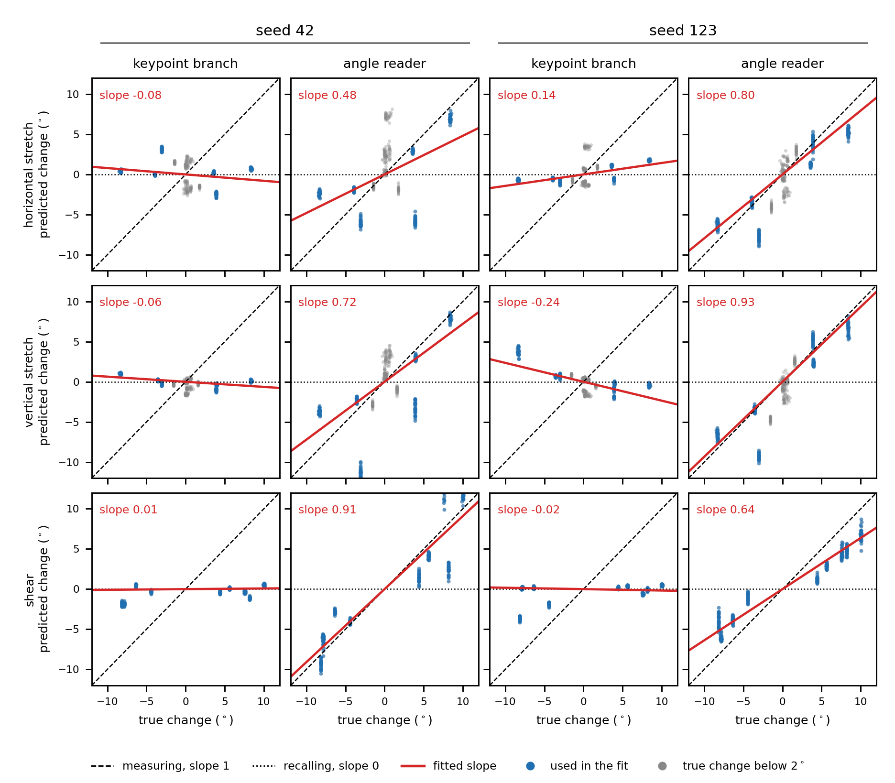
  <br>
  <sub>Predicted vs. true angle change on the test set. The keypoint branch stays flat (slopes −0.24 to 0.14), so it recalls. The angle reader follows the probes (slopes 0.48 to 0.93), so it measures.</sub>
</p>

Ablations on the validation set (MAE in degrees, seed 42 / seed 123):

| Run | Keypoint branch | Angle reader | Spray lances paired (of 96) |
| :--- | :---: | :---: | :---: |
| Final model | 1.55 / 2.02 | 1.82 / 1.49 | 96 / 96 |
| Without class-routed masking | 12.25 / 11.86 | 11.64 / 4.17 | 64 / 64 |
| Without observability loss | 0.37 / 0.85 | 1.17 / 3.71 | 95 / 64 |

### Failure cases

<p align="center">
  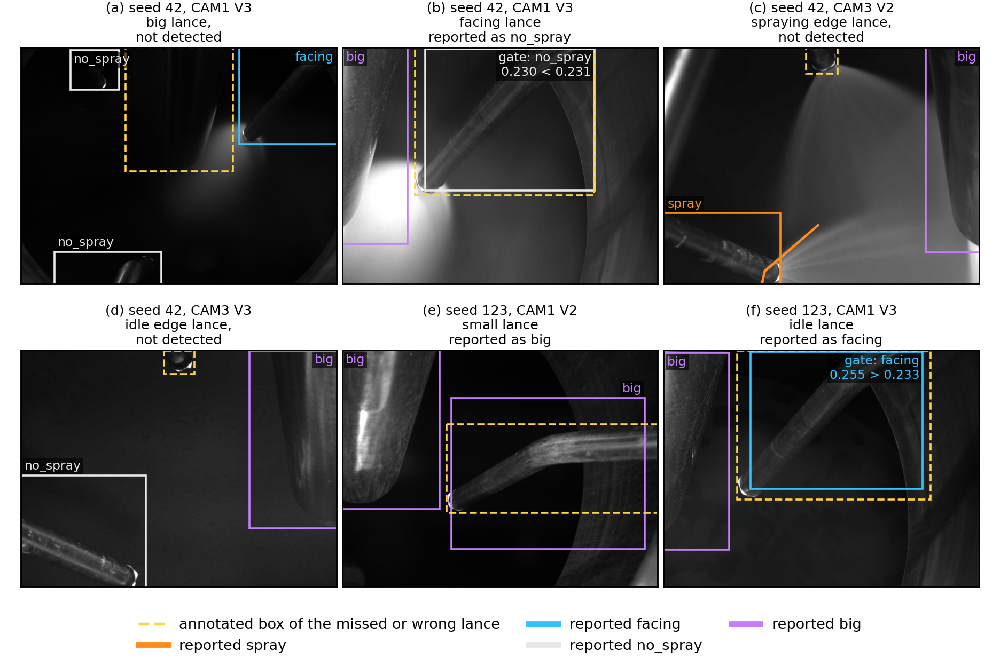
  <br>
  <sub>One example of each error type. The dashed box is the affected lance. (a) A dark big lance is missed. (b) A facing lance falls just below the gate threshold (0.230 &lt; 0.231). (c, d) An edge lance with only its tip in view is missed. (e) A small lance is reported as big. (f) An idle lance lies just above the gate threshold.</sub>
</p>

Across the 8760 annotated test lances, seed 42 misses 475 and reports 133 with the wrong state. Seed 123 misses 559 and reports 1538 with the wrong state, mostly `no_spray` or `facing` lances reported as `big`.

### Raspberry Pi 5 deployment

The final model runs with ONNX Runtime only (no PyTorch) on a Raspberry Pi 5 with 4 GB, 4 threads and no accelerator. Times are in ms, mean over 100 frames after 20 warm-up frames.

| Stage | Seed 42 | Seed 123 |
| :--- | :---: | :---: |
| Frame decoding | 8.4 | 7.7 |
| Preprocessing | 27.0 | 31.2 |
| **Forward pass** | **93.5** | **87.8** |
| Decoding + NMS | 2.1 | 1.9 |
| Mist gate + angle reader | 3.2 | 3.6 |
| **Total per frame** | **134.2** | **132.3** |
| Sustained throughput | 7.41 FPS | 7.52 FPS |
| Memory (peak) | 192 MB | 192 MB |
| SoC temperature (peak) | 76.0 °C | 78.8 °C |

On the PC, the ONNX graphs match PyTorch float32 over all 2255 test frames: 0 frames with a different detection count, 0 different states, and angle differences up to 7e-5°.

```bash
# 1. Export the ONNX graphs from your own trained checkpoint: run from train/model_2
python deploy/export_onnx_final.py

# 2. Copy deployment/pi5_final/ to the Pi, then run both seeds
cd ~/pi5_final && chmod +x run.sh && ./run.sh      # creates .venv on first run

# or one seed by hand
python3 benchmark.py --seed 42 --threads 4
```

Results are written to `results/pi5_s{42,123}.json`. See [`deployment/pi5_final/README.md`](deployment/pi5_final/README.md) for the full protocol and [`MODELS.md`](deployment/pi5_final/MODELS.md) for the SHA-256 of each exported graph.

### Training and evaluation

```bash
# train one run (writes to train/model_2/checkpoint/<run_name>/)
python train/model_2/structure/train.py --run_name v10_ref_s42 --seed 42

# evaluation scripts, runnable from anywhere
python train/model_2/evaluation/eval_test_metrics.py
python train/model_2/evaluation/eval_counterfactual.py     # the measuring vs. recalling probes
python train/model_2/evaluation/thesis_tables_ch6.py       # regenerate the Chapter 6 tables
```

The final model is run 7 (`abl_heads`). Seed 42 is from epoch 76 and seed 123 from epoch 42. Hyperparameters were tuned **only on the validation set**, and the test set was run once, for the final model.

## Live Inspection App (OpenCV + AFGNet v10)

The interactive runtime runs two pipelines side by side. The **OpenCV engine** owns the geometry and runs on every frame. The final **AFGNet v10** model runs in a background thread (~0.5 s) and contributes the state of each lance, which gates which measurements are reported. If the model is missing or slow, the app keeps running with geometry only.

<p align="center">
  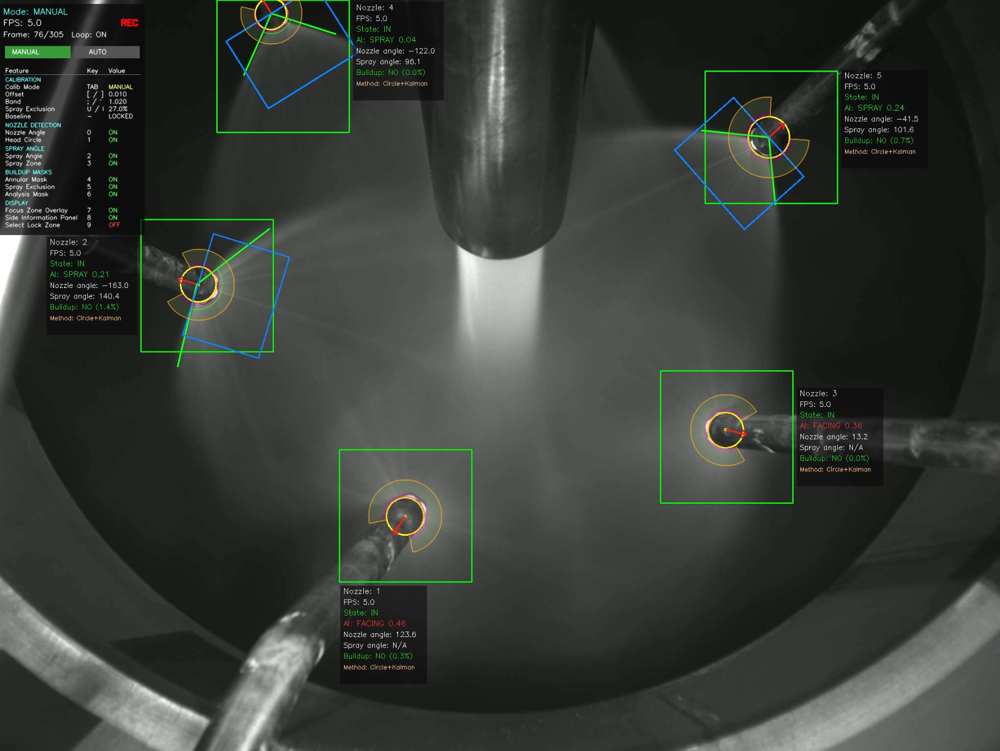
  <br>
  <sub>Merged runtime in MANUAL mode. Each nozzle gets a CV ROI (orange/yellow) and the AI detection (blue), with the predicted class, spray angle and buildup status.</sub>
</p>

**Reading the overlay:**

| Field on screen | Source | Meaning |
| :--- | :--- | :--- |
| `Nozzle: N` | CV | Zone / nozzle index (one ROI = one nozzle) |
| `AI: <class> <score>` | AFGNet v10 | Lance state and confidence (e.g. `AI: SPRAY 0.21`) |
| `Nozzle angle` | CV | Orientation of the nozzle body, in degrees |
| `Spray angle` | CV | Spray-cone angle, shown only when the class gate allows it |
| `Buildup: <yes/no> (NN%)` | CV | Buildup verdict and area percentage |
| `Method` | CV | Which estimator produced the spray angle (Hough / polar / orientation fallback) |
| `Mode` · `FPS` · `REC` | Runtime | Active mode (DYN/FIX/MANUAL), frame rate, recording state |

### Installation

Prerequisites: Python 3.10+ (3.11 in development) and a webcam or video file. CUDA 12.x is optional and only needed for GPU training.

```bash
git clone https://github.com/hiquastar/dry-nozzle-inspection-system.git
cd dry-nozzle-inspection-system

python -m venv venv
source venv/bin/activate            # Windows: venv\Scripts\activate
pip install -r requirements.txt
```

```
# Runtime: OpenCV pipeline + ONNX inference (all the Pi needs)
opencv-python  numpy  PyYAML  onnxruntime  scikit-image

# Training only (GPU machine)
torch  timm  onnx  matplotlib
```

### Quick start

```bash
python app/run_inspection.py --source path/to/video.mp4   # full app
python app/run_onnx_video.py --video path/to/video.mp4    # ONNX model only, no CV
```

Without model files in `deployment/pi5_final/models/`, the app runs the OpenCV pipeline only.

The app starts in `VIDEO` preview and does nothing until you pick a mode:

| Key | Mode | What it does |
| :---: | :--- | :--- |
| `D` | **DYN** | Dynamic zoning: auto-tracks nozzles across the frame |
| `F` | **FIX** | Fixed `grid_rows × grid_cols` zones |
| `M` | **MANUAL** | Profile editor: draw or lock zones by hand. `I` auto-detects ROIs with the AI, `V` previews the auto-ROI pipeline |

| Key | Action | Key | Action |
| :---: | :--- | :---: | :--- |
| `space` | Pause / resume | `S` | Start / stop recording |
| `R` | Reset trackers | `O` | Toggle video auto-loop |
| `I` | Force one AI re-classification | `-` / `=` | Shrink / grow window 10 % |
| `9` | Toggle lock-select mode | `Tab` | Cycle zone (lock on) / buildup calibration (lock off) |
| `L` | Lock / unlock selected zone | `q` | Quit |
| `0`–`8` | Toggle overlays (angle, head circle, spray lines, masks, focus panel…) | `[` `]` `;` `'` | Adjust buildup annulus offset / band |

### Pipeline A: OpenCV

Classical computer vision: contour and circle detection per zone, then spray-angle and buildup measurement inside each nozzle ROI.

<p align="center">
  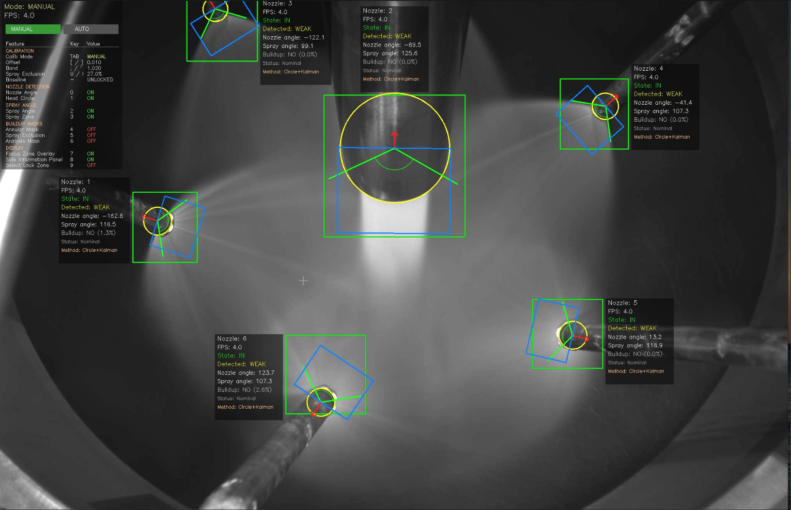
</p>

```
Frame (BGR)
  → grayscale + Gaussian blur
  → grid split: 6 × 3 = 18 zones
  → per zone: NozzleDetector.detect()
        Hough circles (dp 1.2, min_dist 35, param1 60, param2 24, r 10–160 px)
        + contour filter (220–120 000 px) + Kalman + geometry lock
        → {position, orientation, radius}
  → SprayAngleDetector.estimate()   Hough / polar energy / envelope + Kalman → spray_angle_deg
  → BuildupDetector.detect()        Canny(50,150) on the head annulus (outer ×1.45, inner ×0.82)
                                    + GLCM texture vs. baseline → buildup %, "YES" at ≥ 7 %
  → overlay + warning (NORMAL / WARNING / CRITICAL)
```

```python
from nozzle_inspection.modules.nozzle_detector import NozzleDetector
from nozzle_inspection.modules.spray_angle_detector import SprayAngleDetector
from nozzle_inspection.modules.buildup_detector import BuildupDetector

nozzle = NozzleDetector(config)
spray  = SprayAngleDetector(config, total_zones)
build  = BuildupDetector(config)

info = nozzle.detect(frame_bgr)                 # {detected, position, orientation, radius, ...}
ang  = spray.estimate(frame_bgr, zone)          # {detected, spray_angle_deg, lines, ...}
bup  = build.detect(frame_bgr, info, zone_id)   # {buildup, percentage, severity, ...}
```

Each detector returns **a dict per nozzle or zone**, not a list of boxes.

### Pipeline B: AFGNet (ONNX)

By default the app runs the **final model, AFGNet v10**, through the Pi 5 package in [`deployment/pi5_final/`](deployment/pi5_final/). It uses the same decode, mist gate and angle reader as Chapter 6. Its output matches `deployment/pi5_final/reference/` exactly for both seeds (120 frames, 0 different states). The reported class is the **final state** after the mist gate, and spray lances also get `angle_deg` from the angle reader. The ONNX graphs in `pi5_final/models/` are not in git. Build them with `python deploy/export_onnx_final.py` from `train/model_2`.

```python
from nozzle_inspection.modules.dl_inference import load_afgnet
model = load_afgnet("deployment/pi5_final", seed=42)   # a folder -> AFGNet v10
detections = model.detect(frame_bgr)   # [{box, class_id, class_name, score, keypoints, angle_deg?}, ...]
```

To go back to the **earlier AFGNet v9**, set `dl_model_path` to an exported v9 `.onnx` file (a file loads v9). v9 is a single-stage multi-task detector (~7 MB ONNX) on a 640 × 640 input with one 40 × 40 feature map. It uses the same MobileNetV4-Conv-Small + LightFPN backbone as the final model, but without the mist head or the angle reader.

<table>
  <tr>
    <td width="50%">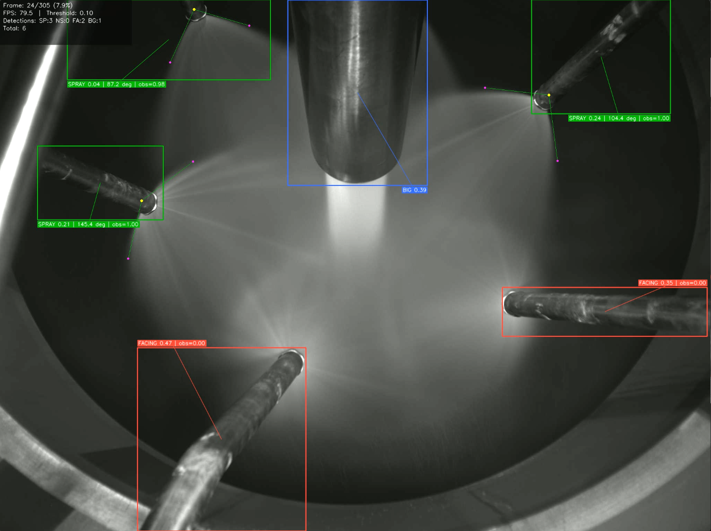</td>
    <td width="50%">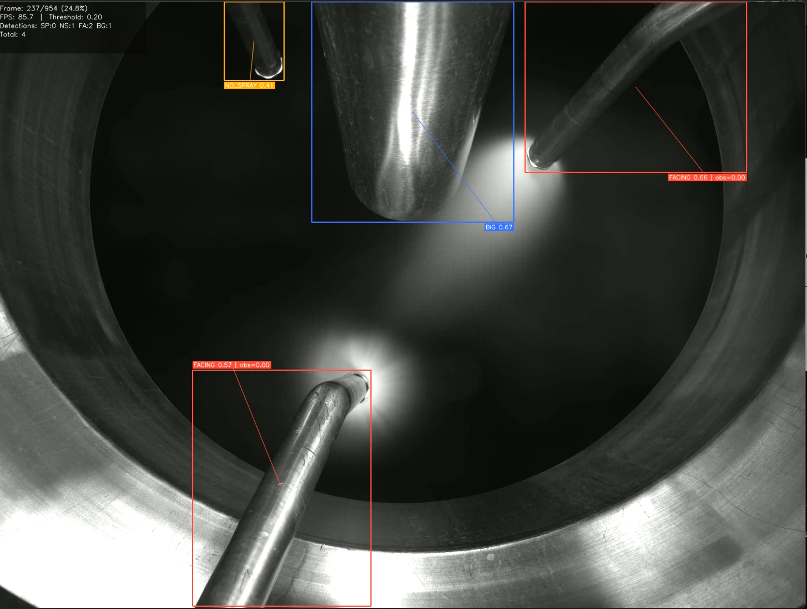</td>
  </tr>
  <tr>
    <td align="center"><sub>AFGNet v9 on a full frame</sub></td>
    <td align="center"><sub>The same model on a tighter cross-section view</sub></td>
  </tr>
</table>

| Parameter | Value |
| :--- | :--- |
| Heads per cell | centerness + box (5) · IoU (1) · class (4) · 3 keypoints + observability (7) |
| Decode | objectness ≥ 0.10, NMS IoU 0.50, observability gate 0.3 |
| Training | 100 epochs · batch 16 · LR 1e-4 · loss weights obj 1 · box 8 (GIoU) · cls 2 (QFL) · kpt 30 · obs 2 · iou 2 |
| Latency (forward) | ~70 ms on Pi 5 · ~15 ms on an x86 CPU |


### Fusion and class gate

Fusion uses **priority override**: CV is primary and owns the ROI and geometry, and the model fills in the class and the observability flag for each ROI (`zone_metrics.py`). The class then decides which measurements are reported (`gate_from_class_id` in `dl_inference.py`):

| Class | id | Spray angle? | Buildup? | Meaning |
| :--- | :---: | :---: | :---: | :--- |
| `nozzle_spray` | 0 | ✅ | ✅ | Spraying, cone measurable |
| `nozzle_no_spray` | 1 | ❌ | ✅ | Real nozzle, not spraying |
| `nozzle_facing` | 2 | ❌ | ✅ | Spraying toward the camera, cone not observable |
| `big_nozzle` | 3 | ❌ | ❌ | Large central nozzle, skipped |

CV owns the measurement because the dataset is small and imbalanced (828 `spray` boxes against 10 409 `facing`), so an end-to-end detector would be data-starved and hard to explain. The model supplies only the judgement CV cannot make: *is this nozzle spraying, and is its cone measurable?*

### Auto-ROI: the AI proposes, CV refines

The raw AI box jitters between frames. That is fine for a class label but not for measurement. `auto_roi.generate_auto_rois` expands each AI box, snaps it to the real nozzle head with the CV Hough refiner, builds a fixed square ROI, and rejects overlaps, so one ROI always means one nozzle. Press **`V`** in the MANUAL editor to see each step (and **`I`** to run it):

<p align="center">
  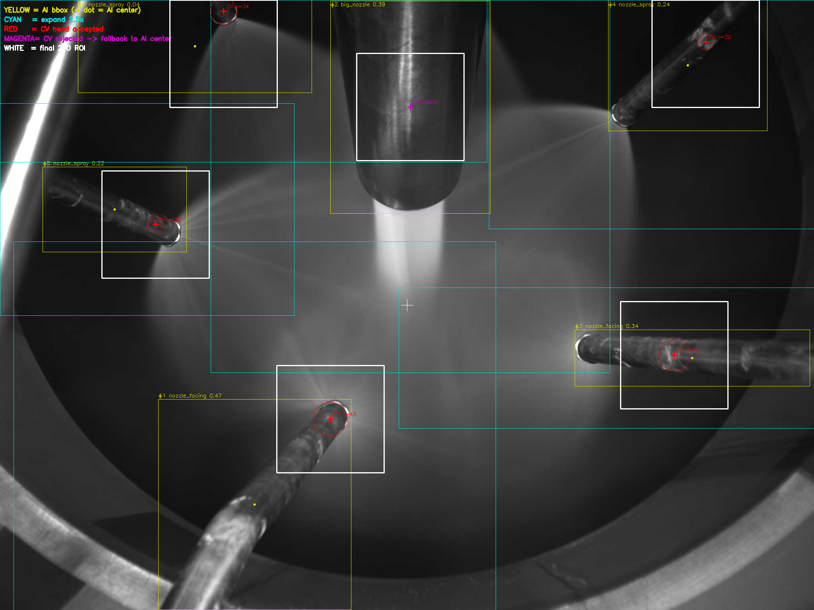
</p>

| Colour | Step |
| :--- | :--- |
| 🟡 Yellow box | AI bounding box (the proposal) |
| 🟦 Cyan box | Box expanded ~2.5×, the search window for the CV Hough refiner |
| 🔴 Red circle + cross | CV-refined nozzle-head centre (falls back to the AI centre if Hough finds nothing) |
| ⬜ White box | Final fixed square ROI, centred on the CV head, used for measurement |

### Runtime architecture

The two pipelines run on different clocks and never block each other:

```
 CV loop      ─frame─►─frame─►─frame─►─frame─►─frame─►   (every frame)
 (Pipeline A)    └────── reads per-zone class cache ──┘
                        ▲                       ▲
 DL ticker     ────────●───────────────────────●──────   (~every 0.5 s)
 (Pipeline B)     AFGNet on the full frame → per-zone class
```

```
run_inspection.py main()
  └► NozzleInspectionSystem.run() → runtime_io.run(system)
       while True:
         camera.read_frame()
         system.process_frame(frame)      # modules/frame_pipeline.py
             input → detection → analysis (reads the DL cache, applies the gate)
                   → tracking → presentation
         _publish_to_dl_ticker(frame)     # DLStatusTicker thread → AFGNetInference.detect()
         cv2.imshow(...)
         runtime_keys.handle_runtime_key(key)
```

### v9 results

These are results of the earlier v9 model, before the mist map was added. Validation was used for model selection, and the test set is held out.

| Metric | Target | Validation | Test |
| :--- | :---: | :---: | :---: |
| Angle MAE (per instance) | ≤ 5.0° | — | 1.70° |
| mAP@50 | 0.80 | 0.708 | 0.659 ⚠️ |
| Weighted F1 (4 classes) | — | 0.721 | 0.708 |
| Observability F1 | 0.85 | 0.890 | 0.529 ⚠️ |

The probes above show that a keypoint-based angle can reach a low error by recalling the lance rather than measuring the cone. The v9 angle has not been probed this way, so its 1.70° should be read with that in mind. `no_spray` recall in v9 was only 0.448. That weakness is what the mist gate of the final model fixes.

## Dataset

There are 6439 annotated frames from nine recordings, with 24 433 boxes in COCO format. The splits are **by recording** (`data/scripts/create_splits_reverse.py`), not random, because consecutive video frames are near-duplicates and a random split would leak them across train and test. The frames and labels themselves are not published.

| Recording | Split | Frames | `spray` | `facing` | `no_spray` | `big` |
| :--- | :--- | ---: | ---: | ---: | ---: | ---: |
| CAM1 V1 | val | 921 | 0 | 1304 | 538 | 921 |
| CAM1 V2 | test | 954 | 0 | 1114 | 794 | 954 |
| CAM1 V3 | test | 954 | 0 | 2140 | 722 | 954 |
| CAM2 V1 | train | 954 | 0 | 2101 | 763 | 954 |
| CAM2 V2 | train | 953 | 0 | 1863 | 996 | 953 |
| CAM2 V3 | train | 953 | 0 | 1333 | 575 | 953 |
| CAM3 V1 | train | 157 | 0 | 0 | 784 | 157 |
| CAM3 V2 | train / val / test | 276 | 828 | 554 | 0 | 276 |
| CAM3 V3 | test | 317 | 0 | 0 | 1585 | 317 |

Every `spray` label comes from CAM3 V2. This is the main limitation of the angle results.

## Project Structure

```
app/
├── run_inspection.py          ENTRY: live inspection app (OpenCV + AFGNet v10)
├── run_onnx_video.py          ENTRY: AFGNet v9 alone on a video
└── test_spray_override.py     check of the spray override on one frame
src/nozzle_inspection/modules/ code of the live app
    ├── frame_pipeline.py      per-frame flow: input → detection → analysis → lock snapshots → overlay
    ├── nozzle_detector.py     CV geometry (Hough + contour + Kalman)
    ├── spray_angle_detector.py
    ├── buildup_detector.py
    ├── dl_inference.py        loads AFGNet v10 (pi5_final) or v9 ONNX, class gate
    ├── dl_status_ticker.py    background DL thread (~0.5 s)
    ├── auto_roi.py            AI box → CV refine → square ROI
    └── zone_metrics.py        merge: CV measurements gated by the DL class
config/                        config.yaml, manual_zones.json
train/
├── model_2/                   final model, AFGNet v10 (thesis)
│   ├── structure/             config, dataset, targets, loss, model, mist masks, train
│   ├── evaluation/            scripts: test metrics, probes, thesis tables and figures
│   └── deploy/                ONNX export, parity check, Pi 5 packaging
└── model_1/                   earlier AFGNet v9, same layout
    ├── structure/             config, dataset, targets, loss, model, train
    ├── evaluation/            scripts: test metrics, confusion matrices, benchmarks
    └── deploy/                ONNX export
deployment/pi5_final/          final model on the Raspberry Pi 5 (pipeline, benchmark, run.sh)
data/scripts/                  create_splits_reverse.py (the data itself is not published)
docs/
├── images/                    figures used in this README (thesis figures in images/thesis/)
└── media/                     screenshots of the live app
```

## Configuration

The live app is configured in [`config/config.yaml`](config/config.yaml), and the final model in [`deployment/pi5_final/config.json`](deployment/pi5_final/config.json).

| Parameter | Default | Description |
| :--- | :--- | :--- |
| `nozzle_detection.dl_model_path` | `deployment/pi5_final` | AI model of the live app: a folder loads AFGNet v10, an `.onnx` file loads AFGNet v9 |
| `nozzle_detection.dl_seed` | `42` | AFGNet v10 seed to load (`42` or `123`) |
| `nozzle_detection.grid_rows` / `grid_cols` | `6` / `3` | Zone grid |
| `nozzle_detection.min_contour_area` | `220` | Smallest contour kept as a nozzle candidate |
| `buildup_detection.buildup_area_threshold` | `0.07` | "Buildup YES" at ≥ 7 % of nozzle area |
| `warning.buildup_warning_level` | `0.07` | Buildup % that raises a WARNING |
| `display.window_scale_percent` | `100` | Initial window size (resize live with `-` / `=`) |
| Final model: detection threshold / NMS IoU | `0.35` / `0.5` | `pi5_final/config.json` |
| Final model: gate disk radius / threshold | `0.45 × max(w, h)` / `0.231` (s42), `0.233` (s123) | Mist gate at the lance tip |

## Troubleshooting

| Symptom | Likely cause | Fix |
| :--- | :--- | :--- |
| `AI: ...` never shows | `pi5_final/models/` is empty or `dl_model_path` is wrong | Build the v10 models (see below), then check `dl_model_path` |
| Window opens but nothing is detected | Still in `VIDEO` preview | Press `D`, `F` or `M` |
| `Spray angle` stays `N/A` on a spraying nozzle | Class gate closed (`no_spray` / `facing`), or no cone found | Press `I` to re-classify, and check the lighting |
| `pi5_final/models/` is empty | The final ONNX graphs are not in git | Run `python deploy/export_onnx_final.py` from `train/model_2` |
| Camera does not open | Wrong source index | Set `camera.source` in `config.yaml` or pass `--source <file>` |
| Very low FPS | Window too large or heavy overlays | Press `-` to shrink, and turn overlays off with `0`–`8` |
| README images broken on GitHub | Folder-name casing | Images are tracked under lowercase `docs/media/` and `docs/images/`. Keep that casing in links |
| `import torch` fails at runtime | Only the runtime dependencies are installed | `torch` is training-only. The runtime needs `onnxruntime` |

## Glossary

| Term | Meaning |
| :--- | :--- |
| **Lance / nozzle** | A spray lance inside the dryer, with the nozzle at its tip |
| **Observability** | Whether the spray cone is geometrically measurable in this frame: `spray` = 1, `facing` = 0 |
| **Mist evidence map** | A per-pixel map (stride 4) of where spray mist is, predicted by the mist head |
| **Mist gate** | Decides `facing` vs. `no_spray` from the mean of the mist map at the lance tip |
| **Angle reader** | A small 1-D conv network that reads the apex angle from a polar profile of the mist map |
| **Class-routed masking** | The loss trains each task only on the classes where it is physically meaningful |
| **Probe** | A stretch or shear of the input that changes the true angle while the lance stays in place |
| **Position-lookup baseline** | Returns the training angle of the lance at the same position; it shows how far recall alone gets |
| **Spray angle / apex angle** | The opening angle of the spray cone, in degrees |
| **Nozzle angle** | The orientation of the nozzle body, in degrees |
| **Buildup** | Material caked on the nozzle head, as a % of nozzle area |
| **ROI / zone** | The fixed square crop around one nozzle, and the grid cell that tracks it |
| **DYN / FIX / MANUAL** | The live app's modes: dynamic zoning, fixed grid, and hand-drawn zones |
| **Ticker** | The background thread (`DLStatusTicker`) that runs AFGNet v10 every ~0.5 s |

## License and Citation

Distributed under the Apache License 2.0. See [`LICENSE`](LICENSE).

```bibtex
@mastersthesis{afgnet_nozzle_2026,
  title  = {Observability-Aware Multi-Task Learning for Spray Nozzle Inspection},
  author = {Hieu Tran},
  year   = {2026},
  school = {Halmstad University},
  note   = {https://github.com/hiquastar/dry-nozzle-inspection-system}
}
```
